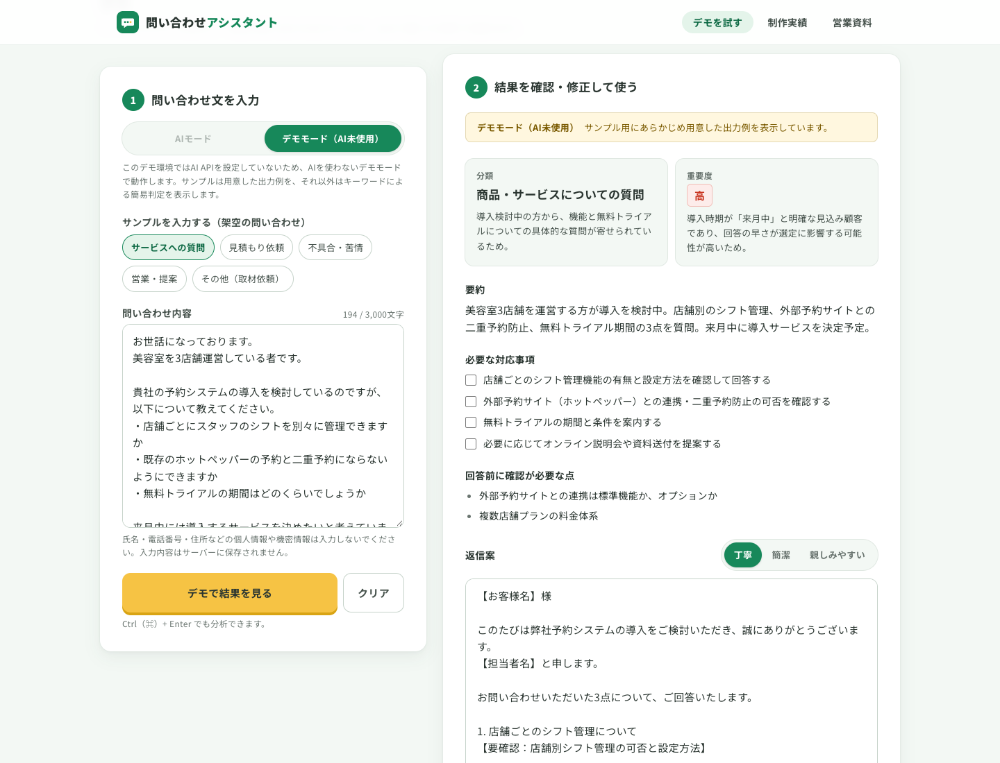

# 問い合わせ対応アシスタント（自主制作デモ）

問い合わせ文を入力すると、生成AIが **分類・要約・重要度の判定・対応事項の抽出・トーン別の返信案の作成** を行うWebアプリです。
ポートフォリオとして個人で企画・制作した自主制作デモであり、実在の企業への導入実績はありません。

- デモ：https://ai-inquiry-assistant-xi.vercel.app （公開版はデモモードで動作）
- 実績紹介：https://ai-inquiry-assistant-xi.vercel.app/works
- 営業用資料：https://ai-inquiry-assistant-xi.vercel.app/sheet

- 返信は **自動送信しません**。担当者が確認・修正してからコピーして使う設計です。
- AI APIを設定しなくても **デモモード（AI未使用）** で動作を確認できます。



## 主な機能

| 機能 | 内容 |
| --- | --- |
| 問い合わせの分類 | 商品・サービスについての質問／見積もり依頼／不具合・苦情／営業・提案／その他（判定理由つき） |
| 内容の要約 | 2〜3文で要点を整理 |
| 重要度の判定 | 高・中・低（判定理由つき） |
| 対応事項の抽出 | チェックリスト形式。回答前に確認が必要な点も別に表示 |
| 返信案の生成 | 確定できない情報は `【要確認：〇〇】` として残す |
| トーンの切り替え | 丁寧／簡潔／親しみやすい（1回の生成で3種類を作成し、即時に切り替え） |
| 結果のコピー | 編集後の返信案、または分析結果一式をコピー |
| サンプル入力 | 架空の問い合わせ5件をワンクリックで入力 |
| デモモード | サンプルは用意した出力例、自由入力はキーワードによる簡易判定（どちらもAI未使用と明示） |

ページ構成：

| URL | 内容 |
| --- | --- |
| `/` | デモアプリ |
| `/works` | 発注者向けの実績紹介ページ |
| `/sheet` | 営業用実績資料（A4・2ページ。印刷してPDF保存できます） |
| `/api/analyze` | 分析API（POST） |
| `/api/status` | AIモードが使えるかを返すAPI（GET） |

## 技術構成

- Next.js 16（App Router / Route Handler）
- React 19 / TypeScript
- Tailwind CSS v4
- Anthropic Claude API（`@anthropic-ai/sdk`、Structured Outputs）
- Zod（AIの出力・入力値の検証）
- Vitest（自動テスト）
- 公開先：Vercel を想定（データベースは使用していません）

処理の流れ：

```
ブラウザ ──POST /api/analyze──▶ Route Handler
                                 ├─ 入力チェック（空欄・文字数）
                                 ├─ デモモード → 出力例 or キーワード判定（AI未使用）
                                 └─ AIモード  → アクセスコード確認 → 回数制限
                                                 → Claude API（JSON形式を指定）
                                                 → Zodで再検証 → 画面へ
```

## ローカルでの起動方法

必要なもの：Node.js 20.9 以上（22 で動作確認）、npm

```bash
npm install
cp .env.example .env.local   # AIを使う場合のみ編集
npm run dev
```

http://localhost:3000 を開きます。`.env.local` を作らなくてもデモモードで動作します。

その他のコマンド：

```bash
npm run typecheck   # 型チェック
npm run lint        # ESLint
npm test            # 自動テスト（Vitest）
npm run build       # 本番ビルド
npm start           # ビルド後のアプリを起動
```

## 環境変数

`.env.example` をコピーして `.env.local` を作成します。**`.env.local` はGitにコミットされません。**

| 変数名 | 必須 | 説明 |
| --- | --- | --- |
| `ANTHROPIC_API_KEY` | AIモードを使う場合 | Anthropic の APIキー。未設定ならデモモードのみ |
| `ANTHROPIC_MODEL` | 任意 | 使用するモデル。省略時 `claude-opus-5-5` |
| `AI_ACCESS_CODE` | 任意（公開時は推奨） | 設定すると、AIモードの利用にこのコードの入力が必要 |
| `AI_RATE_LIMIT_PER_HOUR` | 任意 | 1時間あたりのAI利用回数の上限（IPごと・目安）。省略時 20 |
| `NEXT_PUBLIC_AUTHOR_NAME` | 任意 | 実績紹介・営業資料に表示する制作者名 |
| `NEXT_PUBLIC_DEMO_URL` | 任意 | 公開デモのURL |
| `NEXT_PUBLIC_SOURCE_URL` | 任意 | ソースコード（GitHub）のURL |
| `NEXT_PUBLIC_CONTACT_URL` | 任意 | 相談窓口のURL（クラウドワークス等のプロフィールなど） |
| `NEXT_PUBLIC_CONTACT_LABEL` | 任意 | 相談ボタンの表示名 |

`NEXT_PUBLIC_` で始まる値はブラウザに公開されます。秘密情報は入れないでください。`NEXT_PUBLIC_` の値はビルド時に埋め込まれるため、変更したら再ビルド（Vercelでは再デプロイ）が必要です。

## AI APIの設定方法

1. [Anthropic Console](https://console.anthropic.com/) でアカウントを作成し、APIキーを発行します（従量課金です）。
2. `.env.local` の `ANTHROPIC_API_KEY=` にキーを設定します。
3. 開発サーバーを再起動すると、画面の「AIモード」が選べるようになります。

実装のポイント（`src/lib/ai.ts`）：

- `client.beta.messages.parse()` と Zod スキーマで、出力を決まったJSON形式に固定しています。
- 受け取った後も `normalizeAnalysis()` で中身を検証し、空の要約などは「想定外の応答」として扱います。
- 推論の深さ（`effort`）は `low` に設定し、応答時間と費用を抑えています。
- モデルが安全上の理由で応答を断った場合に、Anthropic側で別モデルに切り替える `fallbacks: "default"`（beta）を有効にしています。
- 問い合わせ文は `<inquiry>` タグで囲み、文中の指示に従わないようシステムプロンプトで指示しています。

費用の目安はモデルと文章量で変わります。最新の料金は Anthropic の料金ページで確認してください。

## デモモードの説明

AI APIキーが未設定、または画面で「デモモード（AI未使用）」を選んだときの動作です。

| 入力 | 表示される結果 | 画面の表示 |
| --- | --- | --- |
| サンプルと同じ本文 | サンプル用にあらかじめ用意した出力例 | 「デモモード（AI未使用）サンプル用にあらかじめ用意した出力例」 |
| それ以外（サンプルを編集した場合も含む） | キーワードによる簡易判定とテンプレートの返信案 | 「デモモード（AI未使用）キーワードによる簡易判定」 |

どちらもAIによる分析ではないことを結果の上部に明示し、AIを使っているような誤解を招かないようにしています。

URLで状態を指定できます（営業資料からのリンクやスクリーンショット用）：

- `/?sample=quote` … サンプル（question / quote / complaint / sales / other）を入力した状態で開く
- `/?sample=quote&run=1&mode=demo` … デモモードで結果まで表示する

## 判定の確認（架空の問い合わせ30件）

`tests/fixtures/eval-inquiries.ts` に、正解ラベル付きの架空の問い合わせを30件（5分類×6件）入れています。キーワードを含まない不具合報告や、質問の形をした営業メールなど、判定しにくい文面もわざと混ぜています。

```bash
npm run eval
```

デモモードのキーワード判定の結果（2026年11月時点）：分類 14/30、重要度 18/30。
AIモードでの採点はまだ行っていません。APIキーを設定したうえで、同じ30件で比べる予定です。

## セキュリティ上の注意

- APIキーはサーバー側（Route Handler）でのみ使用し、ブラウザには送りません。ソースコードにも記載しないでください。
- 問い合わせ本文はサーバーに保存せず、エラーログにも本文は出力しません（エラーの種類のみ記録）。
- **AIモードでは、入力内容が外部のAI事業者（Anthropic）へ送信されます。** 実際の顧客情報を扱う場合は、事業者の利用規約・データの取り扱い方針と、自社の個人情報の取り扱いルールを確認してください。
- 公開URLにAPIキーを設定すると、誰でもAIを呼び出せるため費用が発生します。`AI_ACCESS_CODE` の設定と、Anthropic Console での利用上限（Spend limit）の設定を推奨します。
- 内蔵の回数制限はメモリ上の簡易的なもので、サーバーレス環境ではインスタンスごとに独立します。厳密な制限が必要な場合は Upstash Redis などを利用してください。
- 入力は3,000文字、リクエストは20KBまでに制限しています。
- `X-Frame-Options` などの基本的なセキュリティヘッダーを `next.config.ts` で設定しています。
- AIの出力には誤りが含まれる可能性があります。必ず人が確認してから利用してください。

## デプロイ方法（Vercel）

### GitHub 経由（おすすめ）

1. このフォルダをGitHubのリポジトリにプッシュします（`.env.local` が含まれていないことを確認）。
2. [Vercel](https://vercel.com/) にログインし、「Add New… → Project」からリポジトリをインポートします。
3. Framework Preset が Next.js になっていることを確認します（ビルド設定は変更不要）。
4. 「Environment Variables」に必要な環境変数を設定します。
   - デモモードだけで公開する場合：`ANTHROPIC_API_KEY` は **設定しない**
   - AIモードも公開する場合：`ANTHROPIC_API_KEY` と `AI_ACCESS_CODE` を設定
   - 表示用：`NEXT_PUBLIC_AUTHOR_NAME` / `NEXT_PUBLIC_SOURCE_URL` / `NEXT_PUBLIC_CONTACT_URL`
5. 「Deploy」を押します。発行されたURLを `NEXT_PUBLIC_DEMO_URL` に設定し、再デプロイします。

### Vercel CLI

```bash
npm i -g vercel
vercel login
vercel          # プレビュー環境へデプロイ
vercel --prod   # 本番環境へデプロイ
```

環境変数は `vercel env add ANTHROPIC_API_KEY` などで追加できます。

## ディレクトリ構成

```
.
├── .env.example                 環境変数の設定例
├── docs/
│   ├── screenshots/             画面画像（PC・スマートフォン）
│   ├── sales-sheet.pdf          営業用実績資料（/sheet から出力）
│   ├── pdf-check/               PDFの各ページを画像化した確認用ファイル
│   └── proposal-texts.md        募集サイト掲載用の紹介文・提案文
├── public/screenshots/          実績紹介・営業資料で使う画面画像
├── src/
│   ├── app/
│   │   ├── page.tsx             デモアプリ
│   │   ├── works/page.tsx       実績紹介ページ
│   │   ├── sheet/page.tsx       営業用実績資料（A4・2ページ）
│   │   ├── api/analyze/route.ts 分析API
│   │   ├── api/status/route.ts  AIモードの利用可否
│   │   ├── layout.tsx
│   │   └── globals.css          デザイントークン・印刷設定
│   ├── components/
│   │   ├── InquiryAssistant.tsx 入力〜結果表示の画面
│   │   ├── SiteHeader.tsx       ヘッダー・フッター・ロゴ
│   │   └── PrintButton.tsx
│   ├── config/profile.ts        制作者情報・公開URL（公開前に要設定）
│   ├── content/portfolio.ts     実績紹介・営業資料の文章
│   └── lib/
│       ├── ai.ts                Claude API呼び出し・エラー変換
│       ├── analyze-handler.ts   分析APIの本体（入力チェック・モード分岐）
│       ├── schema.ts            出力スキーマ・入力チェック・正規化
│       ├── samples.ts           サンプル問い合わせと出力例（架空）
│       ├── rule-based.ts        デモモードの簡易判定（AI未使用）
│       └── rate-limit.ts        簡易回数制限
└── tests/                       自動テスト（Vitest）
```

## 公開前チェックリスト

- [ ] `src/config/profile.ts` または環境変数で、制作者名・相談窓口URL・ソースコードURLを設定した
- [ ] 経歴・担当範囲の記載が自分の経験と一致している（会社・チームの実績を含めていない）
- [ ] 「対応可能な類似案件」に、実際に対応できない内容が含まれていない
- [ ] `.env.local` がGitに含まれていない（`git status` で確認）
- [ ] 公開URLにAPIキーを設定する場合、`AI_ACCESS_CODE` と Anthropic Console の利用上限を設定した
- [ ] 公開後のURLで `/`・`/works`・`/sheet` が表示される
- [ ] URLを設定した後、`/sheet` から営業資料のPDFを出力し直した

## 今後の改善案

- メール（Gmail等）・問い合わせフォームとの連携
- 分析履歴の保存と検索（Supabase等）
- 社内FAQや過去の回答を参照した返信案の作成
- 分類カテゴリ・返信テンプレートの会社別カスタマイズ
- 重要度「高」の問い合わせをSlack等へ通知
- 過去の問い合わせを使った精度評価（分類の正解率・修正量の測定）
- ログイン機能とチーム利用、外部ストアを使った厳密な回数制限
- AIの応答のストリーミング表示

## ライセンス・注意事項

ポートフォリオ用の自主制作物です。サンプル問い合わせはすべて架空の内容で、実在の企業・人物とは関係ありません。
